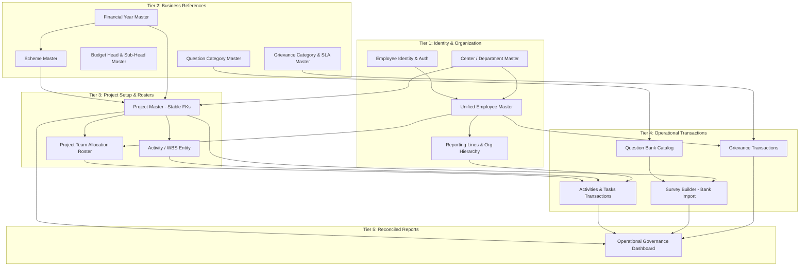

# AIGGPA ERP — Master Data Dependency & Transaction Readiness Audit (Revised Blueprint)

**Document Version:** 2.0.0 (Comprehensive Revision)  
**Audit Date:** October 2026  
**Status:** Audit Completed — Pending Stakeholder Review  
**Target Repository:** `d:\aiggpa-project-management`  
**Scope:** Repository-wide audit of master data, reference inputs, relationships, workflows, and transaction readiness.

---

## 1. Executive Summary

A systematic, repository-wide architectural and data dependency audit of the **AIGGPA ERP Prototype** was conducted to evaluate its readiness for transactional workflows and reporting. This revised audit replaces single-metric readiness generalizations with a rigorous, five-part classification model:
1. **Configurable Masters** (reusable business reference data maintained by authorized personnel)
2. **Core Business Entities & Catalogs** (records with independent business lifecycles and dedicated entry flows)
3. **Relationship Management** (linkages defining organizational authority, project participation, and associations)
4. **Transactions & Workflow Records** (operational records executing day-to-day business actions)
5. **System-Controlled Configuration** (fixed engine rules, technical types, and calculated fields)

### Key Verified Findings

1. **Absence of Dedicated Administrative Master Screens**:
   - Inspection of [`src/auth/config/menuConfig.ts`](file:///d:/aiggpa-project-management/src/auth/config/menuConfig.ts) confirms that the application navigation has **no "Masters" menu section** and **no dedicated screens** for maintaining Centers/Departments, Government Schemes, Financial Years, Budget Heads, Question Categories, or Grievance Categories.
   - Reference data is currently supplied either through hardcoded array literals embedded in JSX files or via pre-seeded mock items in `localStorage`.

2. **Fragmentation Across Organizational Taxonomies**:
   - The application does not suffer from a simple naming error, but from a failure to distinguish between **Organizational Role** (system permission level), **Formal Designation** (HR employment title), **Reporting Relationship** (supervisory hierarchy), and **Project Role** (project-specific duty).
   - This conflation has created four distinct, isolated terminology sets across:
     - Activities & Tasks / Auth Store: 4-Tier Hierarchy (`Center Head` → `Project Manager` / `Research Analyst` → `Fellow` → `Intern`).
     - Projects Desk: Academic Designations (`Senior Advisor`, `Research Associate`, `Fellow`, `Field Investigator`).
     - Surveys Desk: Operational Field Titles (`Chief Program Manager`, `CM Fellow`, `Project Coordinator`, `Intern`).
     - Helpdesk: Hardcoded individuals (`Vikram Singh`, `Priya Patel`).

3. **Orphaned Workflow Pipelines (Broken Upstream-to-Downstream Chains)**:
   - **Question Bank vs. Survey Builder**: [`src/pages/QuestionBankPage.tsx`](file:///d:/aiggpa-project-management/src/pages/QuestionBankPage.tsx) manages a library of questions in `aiggpa_question_bank`. However, [`src/pages/CreateSurveyPage.tsx`](file:///d:/aiggpa-project-management/src/pages/CreateSurveyPage.tsx) has **no integration** with this library; questions can only be authored ad-hoc inside the survey builder.
   - **Projects vs. Surveys**: Field surveys represent research instruments funded by projects, but `CreateSurveyPage.tsx` contains no input to associate a survey with a parent Project.
   - **Missing Activity (WBS) Layer**: While the navigation item is named "Activities & Tasks", the data store ([`src/stores/activityTaskStore.ts`](file:///d:/aiggpa-project-management/src/stores/activityTaskStore.ts)) defines only `ActivityTask` records linking directly to `projectId`. No intermediate `Activity` or Work Breakdown Structure (WBS) entity exists.

4. **Storage of Display Strings Over Immutable Identifiers**:
   - In [`src/pages/CreateProjectPage.tsx`](file:///d:/aiggpa-project-management/src/pages/CreateProjectPage.tsx), form submissions store plain strings (`"Center 11"`, `"Atal Bihari Vajpayee..."`, `['Anis', 'Kiran']`) rather than relational foreign keys (`centerId`, `schemeId`, `employeeId`).

5. **Reviewer Assignment Constraints**:
   - In [`src/pages/activities/CreateTaskModal.tsx`](file:///d:/aiggpa-project-management/src/pages/activities/CreateTaskModal.tsx), the `reviewerId` is unconditionally bound to the task creator (`currentUser.id`). While logical when supervisors create tasks for subordinates, this fails when tasks are created by peers, self-assigned, or require multi-tier administrative approval.

---

## 2. Scope & Evidence Methodology

To ensure factual accuracy, every finding in this report is backed by one of five explicit verification levels:

| Verification Code | Level | Description |
| :---: | :--- | :--- |
| **[V-SRC]** | **Verified Source Code** | Directly confirmed by inspecting component logic, AST structure, types, or store methods in the workspace. |
| **[V-RUN]** | **Verified Runtime / Build** | Confirmed by executing terminal commands (e.g., `tsc`, `vite build`, `eslint`, or automated node test scripts). |
| **[V-INF]** | **Inferred from Model** | Derived logically from TypeScript interfaces, DTO definitions, or component prop signatures. |
| **[V-UNV]** | **Unverified / Missing** | Code or workflow cannot be located or is partially stubbed; requires further exploration. |
| **[V-STK]** | **Stakeholder Decision** | Business policy or domain requirement not determinable from code alone; requires stakeholder confirmation. |

---

## 3. Corrected Data Classification Model

To eliminate confusion between foundational reference tables, transactional documents, and engine configurations, all repository entities are classified into five distinct architectural tiers:

```
┌──────────────────────────────────────────────────────────────────────────────────────────────┐
│                                ARCHITECTURAL DATA TIERS                                      │
├────────────────────────────────┬─────────────────────────────────────────────────────────────┤
│ Tier A: Configurable Masters   │ Independent, reusable business reference data maintained    │
│                                │ by administrators (e.g., Centers, Schemes, Fiscal Years).   │
├────────────────────────────────┼─────────────────────────────────────────────────────────────┤
│ Tier B: Core Business Entities │ Entities with independent lifecycles created via business   │
│         & Catalogs             │ workflows (e.g., Projects, Question Bank Library, Surveys). │
├────────────────────────────────┼─────────────────────────────────────────────────────────────┤
│ Tier C: Relationship Mgmt      │ Associative linkages defining authority and rosters         │
│                                │ (e.g., Reporting Lines, Project Team Allocations).          │
├────────────────────────────────┼─────────────────────────────────────────────────────────────┤
│ Tier D: Transactions & Records │ Operational business execution records                      │
│                                │ (e.g., Tasks, Reviews, Grievance Tickets, Survey Responses).│
├────────────────────────────────┼─────────────────────────────────────────────────────────────┤
│ Tier E: System Configuration   │ Fixed engine constants, calculated fields, and types        │
│                                │ (e.g., Question Formats, Workflow Statuses, Units).         │
└────────────────────────────────┴─────────────────────────────────────────────────────────────┘
```

---

## 4. Reconciled Master & Entity Inventory

Instead of calculating a single distorted readiness metric across fundamentally different concepts, entities are audited in their respective architectural categories.

### 4.1 Configurable Masters (Tier A)

*Reusable business reference data maintained by administrators.*

| Master Name | Business Purpose | Existing Code Location | Current CRUD Support | Persistence | Downstream Consumers | Readiness Status | Evidence |
| :--- | :--- | :--- | :--- | :--- | :--- | :--- | :--- |
| **Employee Master** | Authoritative directory of personnel | `src/stores/activityTaskStore.ts` (`DEFAULT_EMPLOYEES`) | Read only (No create/delete; edit supervisor only via modal) | `localStorage` (`aiggpa_org_employees`) | `authStore`, `ActivitiesPage`, `CreateTaskModal`, `TaskDetailsModal` | **Incomplete** | `DEFAULT_EMPLOYEES` has 17 hardcoded records; no employee creation UI exists. **[V-SRC]** |
| **Center / Department Master** | Directory of AIGGPA policy research centers | `src/pages/CreateProjectPage.tsx` (L1118), `src/auth/features/dashboard/dashboardData.ts` (L7) | Read only (Hardcoded options) | Code constants | `CreateProjectPage`, `ProjectsDashboard` | **Missing** | Three conflicting lists (5 in CreateProject, 6 in dashboardData, 7 in activityTaskStore). No UI. **[V-SRC]** |
| **Government Scheme Master** | State/Central schemes under evaluation | `src/pages/CreateProjectPage.tsx` (L1147), `src/auth/features/dashboard/dashboardData.ts` (L51) | Read only (Hardcoded options) | Code constants | `CreateProjectPage`, `ProjectsDashboard` | **Missing** | 4 schemes in CreateProject; 3 separate schemes in dashboardData. No UI. **[V-SRC]** |
| **Financial Year Master** | Standardized fiscal cycles for budgets & PRC | `src/pages/CreateProjectPage.tsx` (L1176) | Read only (Hardcoded options) | Code constants | `CreateProjectPage`, `ProjectsDashboard` | **Missing** | Hardcoded options (`2026-2027`, `2025-2026`, etc.). No active year toggle or date boundaries. **[V-SRC]** |
| **Budget Head & Sub-Head Master** | Standard chart of project estimation heads | `src/pages/CreateProjectPage.tsx` (L25-65 `CATEGORY_CONFIG`) | Read only (Hardcoded object) | Code constant | `CreateProjectPage` (Budget view & modal) | **Missing** | Fixed object (`HR`, `P&P`, `CTG`, `IOC`); cannot configure new heads or change overhead % without code edits. **[V-SRC]** |
| **Question Category Master** | Thematic domains for survey questions | `src/pages/QuestionBankPage.tsx` (L53 `CATEGORIES`) | Read only (Hardcoded array) | Code constant | `QuestionBankPage` | **Missing** | Array of 8 categories in UI conflicts with category strings in `DEFAULT_QUESTION_BANK` in `projectStore.ts`. **[V-SRC]** |
| **Grievance Category & SLA Master** | Support ticket classifications and target roles | `src/pages/ComplaintsPage.tsx` (L23 `getCategoryName`) | Read only (Hardcoded mapping) | Code constant | `ComplaintsPage` | **Missing** | 6 hardcoded keys (`stipend`, `field_travel`, etc.); no SLA or automated routing configuration. **[V-SRC]** |

---

### 4.2 Core Business Entities & Catalogs (Tier B)

*Records with independent business lifecycles and dedicated entry flows.*

| Entity Name | Business Purpose | Existing Code Location | Current Capabilities | Persistence | Consumers | Readiness Status | Evidence |
| :--- | :--- | :--- | :--- | :--- | :--- | :--- | :--- |
| **Project Master** | Governance research projects & proposals | `src/pages/CreateProjectPage.tsx`, `src/stores/projectStore.ts` | List (Yes), Create (Yes), Edit (Yes), Budget (Yes), Delete (No) | `localStorage` (`aiggpa_projects`) | `ActivitiesPage`, `CreateTaskModal`, `ProjectsDashboard` | **Functional (Prototype)** | Full create/edit forms and budget tree functional in prototype, but references display strings. **[V-SRC]** |
| **Question Bank Library** | Reusable curated survey questions | `src/pages/QuestionBankPage.tsx`, `src/stores/projectStore.ts` | List (Yes), Create Single (Yes), Bulk Import (Yes), Delete (Yes), Edit (No) | `localStorage` (`aiggpa_question_bank`) | None (Surveys do not consume it) | **Functional (Isolated)** | Fully functional authoring and bulk parser; isolated from survey builder. **[V-SRC]** |
| **Project Activity / WBS** | Milestone or work-stream grouping under a project | **DOES NOT EXIST** | None | None | None | **Missing** | Only flat tasks exist in `activityTaskStore.ts`. **[V-SRC]** |
| **Survey Definition** | Field questionnaire instrument | `src/pages/SurveysPage.tsx`, `src/pages/CreateSurveyPage.tsx`, `src/stores/surveyStore.ts` | List (Yes), Create (Yes), View (Yes), Close (No) | `localStorage` (`aiggpa_admin_surveys`) | `SurveysPage` | **Functional (Isolated)** | 2-step survey builder works, but operates with ad-hoc questions and has no link to Projects. **[V-SRC]** |

---

### 4.3 Relationship Management (Tier C)

*Associative linkages defining authority, team membership, and associations.*

| Relationship Name | Connecting Entities | Implementation Location | Current Mechanism | Readiness Status | Evidence & Limitations |
| :--- | :--- | :--- | :--- | :--- | :--- |
| **Employee Reporting Lines** | Employee → Supervisor (Employee) | `src/pages/activities/RelationshipsModal.tsx`, `src/stores/activityTaskStore.ts` | `reportsTo` field on `Employee`; modal allows reassigning supervisor | **Functional (Prototype)** | Enforces role rules (PM/RA report to CH; Fellow to PM/RA; Intern to Fellow). Limited to pre-seeded employees. **[V-SRC]** |
| **Project Team Allocation** | Project → Employee | `src/pages/CreateProjectPage.tsx` (L2000-2200 Assign Team Modal) | Modal saves `assignedDetails` on project object | **Defective** | Stores plain employee names (`['Anis', 'Kiran']`) from hardcoded `EMPLOYEE_DB`; disconnected from `activityTaskStore`. **[V-SRC]** |
| **Project Membership Constraint** | Task Assignee → Project Roster | `src/pages/activities/CreateTaskModal.tsx` | **NOT ENFORCED** | **Missing** | Assignees are filtered only by reporting relationship; anyone in hierarchy can be assigned regardless of project. **[V-SRC]** |
| **Survey-to-Project Association** | Survey → Project | `src/pages/CreateSurveyPage.tsx` | **DOES NOT EXIST** | **Missing** | Survey builder form has no `projectId` field. **[V-SRC]** |
| **Survey-to-Question-Bank Import**| Survey Question → Question Bank Item | `src/pages/CreateSurveyPage.tsx` | **DOES NOT EXIST** | **Missing** | Survey questions must be typed from scratch; cannot pick from Question Bank. **[V-SRC]** |

---

### 4.4 Transactions & Workflow Records (Tier D)

*Operational execution records.*

| Transaction Name | Workflow Stage | Code Location | State Machine / Actions | Persistence | Readiness Status |
| :--- | :--- | :--- | :--- | :--- | :--- |
| **Activity Tasks** | Execution & Tracking | `src/pages/ActivitiesPage.tsx`, `src/pages/activities/TaskCard.tsx` | 5 Kanban Stages: `To Do`, `In Progress`, `In Review`, `Changes Requested`, `Completed` | `localStorage` (`aiggpa_activities_tasks`) | **Functional (Prototype)** |
| **Task Review Decisions** | Formal Quality Gate | `src/pages/activities/TaskDetailsModal.tsx` | Submit for Review, Approve, Request Changes (mandatory feedback), Resubmit | `localStorage` (updates Task & Timeline) | **Functional (Prototype)** |
| **Survey Feedbacks / Submissions** | Field Reporting | `src/pages/SurveysPage.tsx` | Feedback threads with challenges, recommendations, stakeholder counts | `localStorage` (embedded in survey object) | **Functional (Prototype)** |
| **Grievance Submissions** | Helpdesk Filing | `src/pages/ComplaintsPage.tsx` | Submit ticket, simulated voice notes, document attachment | `localStorage` (`aiggpa_complaints_data`) | **Functional (Prototype)** |
| **Grievance Resolutions** | Helpdesk Review | `src/pages/ComplaintsPage.tsx` | Resolve, Reject, Forward with reviewer comment | `localStorage` (`aiggpa_complaints_data`) | **Functional (Prototype)** |
| **Financial Vouchers** | Expenditure Accounting | `src/auth/features/dashboard/dashboardData.ts` (`initialVoucherData`) | Static mock records only (no creation form or ledger posting UI) | In-memory code constant | **Unresolved / Prototype Only** |

---

### 4.5 System-Controlled Configuration (Tier E)

*Fixed engine rules, technical types, and calculated fields that do NOT require business CRUD.*

| Configuration Item | Business / Technical Purpose | Representation in Code | Classification Rationale |
| :--- | :--- | :--- | :--- |
| **Question Answer Formats** | Rendering engine types: Single choice, Multiple choice, Likert Scale, Dichotomous, Numeric, Descriptive | `TYPE_CARDS` in `QuestionBankPage.tsx`, `TYPE_OPTIONS` in `CreateSurveyPage.tsx` | Fixed component rendering logic; cannot be created dynamically by users without custom UI renderers. **[V-SRC]** |
| **Task Workflow Statuses** | 5 Kanban status states (`To Do`, `In Progress`, `In Review`, `Changes Requested`, `Completed`) | `TaskStatus` type in `activityTaskStore.ts` | Hardcoded workflow state machine logic governed by review gates. **[V-SRC]** |
| **Task Priorities** | `Low`, `Medium`, `High`, `Critical` | `TaskPriority` type in `activityTaskStore.ts` | Universal priority scale. **[V-SRC]** |
| **Funding Patterns** | `Internal`, `External`, `Composite`, `Pro Bono` | HTML select in `CreateProjectPage.tsx` | Financial classification enum. **[V-SRC]** |
| **Unit Types** | `Months`, `Days`, `Trips`, `Set`, `Piece`, `% Overhead` | Modal select in `CreateProjectPage.tsx` | Measurement units for rate calculation. **[V-SRC]** |

---

## 5. Separation of Role, Designation, Reporting, and Project Role

The previous audit noted taxonomy fragmentation across modules. Rather than forcing a single flat enum across the enterprise, the corrected architecture separates four distinct organizational concepts:

```
┌───────────────────────────────────────────────────────────────────────────────────────────┐
│                           ORGANIZATIONAL TAXONOMY SEPARATION                             │
├──────────────────────────┬──────────────────────────┬─────────────────────────────────────┤
│ 1. Organizational Role   │ System permissions &     │ Center Head, Project Manager,       │
│    (Security / RBAC)     │ operational authority    │ Research Analyst, Fellow, Intern    │
├──────────────────────────┼──────────────────────────┼─────────────────────────────────────┤
│ 2. Formal Designation    │ Official HR employment   │ Senior Advisor, Lead Policy Fellow, │
│    (HR Title)            │ contract title           │ Research Associate, Data Analyst    │
├──────────────────────────┼──────────────────────────┼─────────────────────────────────────┤
│ 3. Reporting Line        │ Supervisory hierarchy    │ `reportsTo` employee foreign key    │
│    (Managerial Chain)    │ for approvals & reviews  │ (e.g. EMP-IN-01 -> EMP-FL-01)       │
├──────────────────────────┼──────────────────────────┼─────────────────────────────────────┤
│ 4. Project Role          │ Functional role within a │ Principal Investigator, Field Lead, │
│    (Project Team Roster) │ specific project team    │ Survey Coordinator, Enumerator      │
└──────────────────────────┴──────────────────────────┴─────────────────────────────────────┘
```

### 5.1 Existing Code Inspection

1. **`src/stores/activityTaskStore.ts` (L13, L20-29, L95-150)**:
   - Defines `OrgRole = 'Center Head' | 'Project Manager' | 'Research Analyst' | 'Fellow' | 'Intern'` **[V-SRC]**.
   - Defines `Employee` with both `role: OrgRole` and `designation: string`.
   - Seed data distinguishes them: Dr. Rajeshwar Rao has `role: 'Center Head'` and `designation: 'Director & Center Head'`. Aakash Mehta has `role: 'Fellow'` and `designation: 'Lead Policy Fellow'`.
2. **`src/pages/CreateProjectPage.tsx` (L67-88, L2189-2200)**:
   - Uses `Senior Advisor`, `Research Associate`, `Fellow`, `Field Investigator` directly in the Assign Team dropdown **[V-SRC]**.
   - These are **formal designations** or **project roles**, but they were mistakenly treated as the user's primary identity.
3. **`src/stores/surveyStore.ts` (L18-55)**:
   - Uses `Chief Program Manager`, `CM Fellow`, `Project Coordinator (PC)`, `SPM/CPM`, `Intern` **[V-SRC]**.
   - These are **project/program roles** assigned to field personnel during large-scale surveys.
4. **`src/stores/complaintStore.ts` (L15, L99)**:
   - Uses `applicantRole: 'intern' | 'fellow'` and target roles `fellow | pc` **[V-SRC]**.

### 5.2 Recommended Data Model & Legacy Mapping Strategy

```typescript
// Proposed Unified Employee Entity
export interface UnifiedEmployee {
  id: string;                      // Stable ID (e.g., 'EMP-PM-01')
  employeeCode: string;            // Official payroll code (e.g., 'E1042')
  name: string;                    // Full display name
  email: string;
  organizationalRole: OrgRole;     // 'Center Head' | 'Project Manager' | 'Research Analyst' | 'Fellow' | 'Intern'
  designationId: string;           // Ref to Designation Master (e.g., 'Lead Policy Fellow')
  departmentId: string;            // Ref to Center/Department Master
  reportsTo: string | null;        // Ref to supervisor Employee ID
  isActive: boolean;
}

// Proposed Project Allocation Roster Entity
export interface ProjectTeamMember {
  id: string;
  projectId: string;               // Ref to Project Master
  employeeId: string;              // Ref to UnifiedEmployee
  projectRole: string;             // 'Principal Investigator' | 'Field Coordinator' | 'Enumerator'
  allocatedFrom: string;
  allocatedTo: string;
  isActive: boolean;
}
```

*Legacy Terminology Migration Note*: Existing strings such as `Senior Advisor` and `Research Associate` in project teams will be mapped to the `projectRole` or `designationId` fields, while their operational system access is governed by their `organizationalRole`.

---

## 6. Corrected Reviewer & Approver Assignment Model

The previous audit stated that the task creator is automatically the reviewer. Inspection of [`src/pages/activities/CreateTaskModal.tsx`](file:///d:/aiggpa-project-management/src/pages/activities/CreateTaskModal.tsx) (L150-152) confirms this behavior:
```typescript
// Current implementation in CreateTaskModal.tsx
reviewerId: currentUser.id,
reviewerName: currentUser.name,
reviewerRole: currentUser.role,
```

### 6.1 Current Operational Limitations

1. **Self-Review Hazard**: If an authorized user creates a task and assigns it to themselves (e.g., a Project Manager creating an administrative milestone for themselves), `reviewerId` is set to their own ID. If `requiresReview` is true, the assignee can approve their own deliverable unless blocked by UI checks.
2. **Delegation / Peer Task Creation**: If the Center Head instructs a Project Manager to assign a task to a Fellow, but specifies that the Center Head wants final sign-off, the current form has no dropdown to designate an alternate authorized reviewer.
3. **Intern / Subordinate Resubmissions**: When a Fellow requests revisions on an Intern's task, the Intern modifies the checklist and resubmits. The review history and feedback trail must be preserved without overwriting historical notes.

### 6.2 Validated Reviewer Resolution Rules

To ensure governance rigor, the reviewer model must distinguish five distinct actor roles:

```
┌───────────────────────────────────────────────────────────────────────────────────────┐
│                               TASK GOVERNANCE ACTORS                                  │
├─────────────────────┬─────────────────────────────────────────────────────────────────┤
│ Task Creator        │ The authenticated user who initialized the task record.         │
├─────────────────────┼─────────────────────────────────────────────────────────────────┤
│ Task Assignee       │ The operational employee responsible for executing the work.   │
├─────────────────────┼─────────────────────────────────────────────────────────────────┤
│ Designated Reviewer │ The assigned supervisor who conducts technical & field checks. │
├─────────────────────┼─────────────────────────────────────────────────────────────────┤
│ Reporting Manager   │ The employee's official supervisor in the organizational tree.  │
├─────────────────────┼─────────────────────────────────────────────────────────────────┤
│ Authorized Approver │ The final signing authority (Center Head / PM) for completion.  │
└─────────────────────┴─────────────────────────────────────────────────────────────────┘
```

#### Reviewer Assignment Protocol

1. **Default Assignment**: Default `reviewerId` to the creator **only if** the creator is in the direct upward reporting chain of the assignee.
2. **Assignee Exclusion**: An assignee **cannot be their own reviewer** (`assigneeId !== reviewerId`). If self-assignment occurs, `reviewerId` must automatically resolve to the user's `reportsTo` supervisor.
3. **Explicit Reviewer Selection**: In `CreateTaskModal`, provide an optional "Designated Reviewer" selector populated with employees who have equal or higher organizational authority than the assignee.
4. **Audit Trail Immutability**: All review decisions (`Approve`, `Request Changes`) must record:
   - `decision`: `'Approved' | 'Changes Requested'`
   - `actorId` & `actorName`
   - `timestamp` (ISO string)
   - `feedbackText` (mandatory for changes requested)
   - Stored in the task's immutable `timeline` array.

---

## 7. Rebuilt Dependency Graph & Order Validation

The dependency model is restructured to reflect true foreign-key and workflow prerequisites:



### Dependency Order Constraints & Conflict Resolution

1. **Financial Year Precedes Scheme**: A Government Scheme has a specific sanction year (e.g., FY 2025–2026). [`src/auth/features/dashboard/dashboardData.ts`](file:///d:/aiggpa-project-management/src/auth/features/dashboard/dashboardData.ts) (L42) models `financialYear` inside `SchemeItem`. Therefore, `FinancialYearMaster` must be created before `SchemeMaster`.
2. **Circular Dependency: Center vs. Center Head**:
   - A Center has a `headEmployeeId`. An Employee belongs to a `departmentId`.
   - *Resolution*: Create the Center record first with `headEmployeeId: null`, create the Center Head employee record linking to `departmentId`, then update the Center's `headEmployeeId`.
3. **Project Roster Precedes Task Assignment**:
   - Tasks belong to a specific Project (`projectId`).
   - If project-level restrictions are enforced, an employee must be allocated to the project team roster (`ProjectTeamMember`) before appearing in the `CreateTaskModal` assignee dropdown.
4. **Question Bank Precedes Survey Builder**:
   - The Question Bank catalog must be established with searchable categories before `CreateSurveyPage.tsx` can offer an "Import from Question Bank" selector.

---

## 8. Verified Dropdown and Reference-Field Inventory

Every reference input across the repository was inspected in source code. Findings are documented with exact file citations:

| # | Page / Modal | Component & Control Name | UI Control | Classification | Source Entity / State | Stored Representation | Parent-Child / Hierarchy Filtering | Verification Status | Source Code Evidence & Notes |
| :---: | :--- | :--- | :--- | :--- | :--- | :--- | :--- | :---: | :--- |
| 1 | `CreateProjectPage` | `cpDepartment` | HTML `<select>` | **Configurable Master** | Hardcoded JSX options | Plain display string | None | **[V-SRC]** | Lines 1110-1132: 5 hardcoded option strings (`Center 11`, `CPPG`, `CSD`, `CKM`, `CUG`). Stores string. |
| 2 | `CreateProjectPage` | `cpScheme` | HTML `<select>` | **Configurable Master** | Hardcoded JSX options | Plain display string | None | **[V-SRC]** | Lines 1141-1162: 4 hardcoded options (`Atal Bihari...`, `M.P. State Planning...`, etc.). Stores string. |
| 3 | `CreateProjectPage` | `cpFinancialYear` | HTML `<select>` | **Configurable Master** | Hardcoded JSX options | Plain display string | None | **[V-SRC]** | Lines 1170-1183: 4 hardcoded options (`2026-2027`, `2025-2026`, etc.). Stores string. |
| 4 | `CreateProjectPage` | `cpFundingPattern` | HTML `<select>` | **System Config** | Hardcoded JSX options | Enum string | None | **[V-SRC]** | Lines 1191-1203: Options (`Internal`, `External`, `Composite`, `Pro Bono`). |
| 5 | `CreateProjectPage` | `budgetProjectSelect` | HTML `<select>` | **Core Business Entity** | `Store.getProjects()` | Project ID (`p.id`) | None | **[V-SRC]** | Lines 1296-1307: Correctly stores `p.id`. |
| 6 | `CreateProjectPage` (Budget) | `modalBudgetCategory` | HTML `<select>` | **Configurable Master** | `CATEGORY_CONFIG` keys | Category key string | Changes sub-categories | **[V-SRC]** | Lines 1797-1809: Hardcoded object keys (`Human resources`, `Printing & Publications`, `Contingency`). |
| 7 | `CreateProjectPage` (Budget) | `modalBudgetSubCategory`| HTML `<select>` | **Configurable Master** | Derived from category | Sub-category name string| Filtered by `mbCategory` | **[V-SRC]** | Lines 1816-1842: Dynamically derived from `CATEGORY_CONFIG[mbCategory].subCategories`. |
| 8 | `CreateProjectPage` (Budget) | `modalBudgetUnitType` | HTML `<select>` | **System Config** | Hardcoded JSX options | Unit string | None | **[V-SRC]** | Lines 1852-1866: Options (`Months`, `Days`, `Trips`, `Set`, `Piece`, `% Overhead`). |
| 9 | `CreateProjectPage` (Team) | `modalAssignProjectSelect`| HTML `<select>` | **Core Business Entity** | `projects.map()` | Project ID (`p.id`) | None | **[V-SRC]** | Lines 2122-2142: Selects project by ID. |
| 10 | `CreateProjectPage` (Team) | `modalTeamDesignationSelect`| HTML `<select>` | **Configurable Master** | Hardcoded JSX options | Designation string | Changes employee options | **[V-SRC]** | Lines 2176-2200: Options (`Senior Advisor`, `Research Associate`, `Fellow`, `Field Investigator`). |
| 11 | `CreateProjectPage` (Team) | `selectedEmps` | Custom Popover | **Relationship Mgmt** | `EMPLOYEE_DB[desig]` | Array of name strings | Filtered by designation | **[V-SRC]** | Lines 355, 1032: Maps designations to names like `Anis`, `Kiran`, `Priya Verma`. Stores string array. |
| 12 | `ActivitiesPage` | Project Filter | HTML `<select>` | **Core Business Entity** | `projectStore.getProjects()` | Project ID (`p.id`) | None | **[V-SRC]** | Lines 555-570: Filters board by project ID. |
| 13 | `ActivitiesPage` | Assignee Filter | HTML `<select>` | **Configurable Master** | `ActivityTaskStore.getEmployees()` | Employee ID (`e.id`) | None | **[V-SRC]** | Lines 575-588: Uses `e.id`. Correct identifier usage. |
| 14 | `ActivitiesPage` | Priority Filter | HTML `<select>` | **System Config** | Static options | Enum string | None | **[V-SRC]** | Lines 600-612: Options (`Low`, `Medium`, `High`, `Critical`). |
| 15 | `ActivitiesPage` | Status Filter | HTML `<select>` | **System Config** | Static options | Enum string | None | **[V-SRC]** | Lines 615-630: 5 Kanban status options. |
| 16 | `CreateTaskModal` | `projectId` | HTML `<select>` | **Core Business Entity** | `projectStore.getProjects()` | Project ID (`p.id`) | None | **[V-SRC]** | Lines 31, 142: Stores `selectedProj.id`. Correct identifier usage. |
| 17 | `CreateTaskModal` | `assigneeId` | HTML `<select>` | **Relationship Mgmt** | `ActivityTaskStore.getEligibleAssignees(currentUser)` | Employee ID (`e.id`) | Strictly filtered by hierarchy | **[V-SRC]** | Lines 27, 147: Enforces reporting authority (CH -> PM/RA -> Fellow -> Intern). Correct ID. |
| 18 | `CreateTaskModal` | `priority` | HTML `<select>` | **System Config** | Static options | Enum string | None | **[V-SRC]** | Lines 33, 153: Options (`Low`, `Medium`, `High`, `Critical`). |
| 19 | `RelationshipsModal` | `selectedEmpId` | HTML `<select>` | **Configurable Master** | `ActivityTaskStore.getEmployees()` | Employee ID (`e.id`) | None | **[V-SRC]** | Lines 22, 69: Reassigns employee reporting line. Correct ID. |
| 20 | `RelationshipsModal` | `newSupervisorId` | HTML `<select>` | **Relationship Mgmt** | `eligibleSupervisors` | Supervisor Employee ID | Dynamic role validation | **[V-SRC]** | Lines 33-62: Prevents invalid hierarchy loops. Correct ID. |
| 21 | `QuestionBankPage` | Category Selector | HTML `<select>` & Pills | **Configurable Master** | `CATEGORIES` array | Category name string | Filters catalog | **[V-SRC]** | Lines 53-62, 518: 8 hardcoded categories. Mismatches seed data in `projectStore.ts`. |
| 22 | `QuestionBankPage` | Question Format | Visual Selection Cards | **System Config** | `TYPE_CARDS` constant | Format enum string | Alters authoring fields | **[V-SRC]** | Lines 64-101: 6 formats (`Single choice`, `Likert Scale`, etc.). Engine configuration. |
| 23 | `CreateSurveyPage` | Question Format | Visual Selection Cards | **System Config** | `FORMAT_CARDS` constant | Format enum string | Builds ad-hoc questions | **[V-SRC]** | Lines 125-167: 5 builder formats. Engine configuration. |
| 24 | `CreateSurveyPage` | Survey Project Link | **MISSING** | **Relationship Mgmt** | **NOT ON FORM** | None | None | **[V-SRC]** | Inspection confirms no project selector exists on `CreateSurveyPage.tsx`. |
| 25 | `CreateSurveyPage` | Question Bank Import | **MISSING** | **Core Business Entity** | **NOT ON FORM** | None | None | **[V-SRC]** | Inspection confirms survey questions cannot be imported from Question Bank. |
| 26 | `ComplaintsPage` | `addCategory` | HTML `<select>` | **Configurable Master** | Hardcoded JSX options | Category key string | None | **[V-SRC]** | Lines 23-33, 64: 6 hardcoded categories (`stipend`, `field_travel`, etc.). |
| 27 | `ProjectsDashboard` | `selectedScheme` | Shared `DropDownList` | **Configurable Master** | `initialSchemeData` mock | Scheme ID (`sch-1`) | Filters chart data | **[V-SRC]** | Lines 60, 79: Reads mock array in `dashboardData.ts`. Disconnected from projects. |
| 28 | `ProjectsDashboard` | `selectedCenter` | Shared `DropDownList` | **Configurable Master** | `initialCenterData` mock | Center ID (`cat-1`) | Filters chart data | **[V-SRC]** | Lines 9, 80: Reads mock array in `dashboardData.ts`. Disconnected from projects. |
| 29 | `ProjectsDashboard` | `selectedProject` | Shared `DropDownList` | **Core Business Entity** | `allProjects` internal mock | Project ID (`prop-1`) | Switches single project | **[V-SRC]** | Lines 87, 110: Populated primarily by hardcoded internal `mockList`. |

---

## 9. Revalidated Hardcoded Data Audit

All hardcoded datasets were revalidated directly against source code files:

| # | Exact File Location | Identifier / Variable | Classification | Consequence & Impact | Recommended Correction | Verification |
| :---: | :--- | :--- | :--- | :--- | :--- | :---: |
| 1 | `src/pages/CreateProjectPage.tsx` (L67-88) | `EMPLOYEE_DB` | **Confirmed Defect** | Maps designations to names like `Anis`, `Kiran`. None exist in `DEFAULT_EMPLOYEES`. Project assignees cannot log in or participate in tasks. | Replace with employee lookup against `EmployeeMaster` filtering active staff. | **[V-SRC]** |
| 2 | `src/pages/CreateProjectPage.tsx` (L1118-1131) | `cpDepartment` options | **Confirmed Defect** | Hardcoded JSX strings (`Center 11`, `CPPG`, etc.). Conflicts with `initialCenterData` in `dashboardData.ts`. | Replace with dynamic select populated from `CenterMaster`. | **[V-SRC]** |
| 3 | `src/pages/CreateProjectPage.tsx` (L1147-1161) | `cpScheme` options | **Confirmed Defect** | Hardcoded JSX strings. Disconnected from scheme records in `dashboardData.ts`. | Replace with dynamic select populated from `SchemeMaster`. | **[V-SRC]** |
| 4 | `src/pages/CreateProjectPage.tsx` (L25-65) | `CATEGORY_CONFIG` | **Prototype Shortcut** | Hardcoded budget heads & sub-categories. Users cannot define new expenditure heads. | Move to `BudgetHeadMaster` store with extensible CRUD. | **[V-SRC]** |
| 5 | `src/pages/QuestionBankPage.tsx` (L53-62) | `CATEGORIES` array | **Confirmed Defect** | Mismatches initial seed strings in `projectStore.ts` (`DEFAULT_QUESTION_BANK`), breaking category search filters. | Move to `QuestionCategoryMaster` and reconcile seed categories. | **[V-SRC]** |
| 6 | `src/stores/complaintStore.ts` (L13-98) | Complaint users (`u-intern-01`, `Vikram Singh`) | **Confirmed Defect** | Seed records reference arbitrary users disconnected from the active auth session. | Reconcile complaint applicants with `UnifiedEmployee` accounts. | **[V-SRC]** |
| 7 | `src/auth/features/dashboard/dashboardData.ts` (L137-250) | `initialVoucherData` | **Unresolved Requirement** | Rich financial voucher debits/credits exist in mock data, but no Voucher Entry page or Ledger Master exists. | Confirm whether Financial Accounting is in prototype scope. | **[V-STK]** |
| 8 | `src/pages/LoginPage.tsx` (L1-390) | Entire component | **Confirmed Defect (Orphan)**| Dead code. Routing in `App.tsx` routes `/login/*` to `src/anonymous/pages/Login.tsx`. | Remove file to prevent maintenance confusion. | **[V-SRC]** |
| 9 | `src/services/mockData.ts` (L1-142) | `mockUsers`, `mockKpiMetrics` | **Confirmed Defect (Orphan)**| Starter-kit boilerplate data (`Aarav Sharma`) unrelated to AIGGPA. | Remove file or isolate to unused demo routes. | **[V-SRC]** |

---

## 10. Dependency-Aware Implementation Roadmap (5 Phases)

To guide future implementation, tasks are organized into five dependency-ordered phases:

```
┌─────────────────────────────────────────────────────────────────────────────┐
│                    DEPENDENCY-AWARE IMPLEMENTATION PHASES                   │
├─────────────────────────┬───────────────────────────────────────────────────┤
│ Phase 1: Identity & Org │ Unified Employee Master, Center/Department Master,│
│                         │ Reporting Lines, Role & Designation Config        │
├─────────────────────────┼───────────────────────────────────────────────────┤
│ Phase 2: Foundational   │ Financial Year Master, Scheme Master,             │
│          References     │ Budget Head & Sub-Head Master                     │
├─────────────────────────┼───────────────────────────────────────────────────┤
│ Phase 3: Project Setup  │ Project FK Refactor, Team Allocation Rosters,     │
│          & Rosters      │ Activity / WBS Entity Definition                  │
├─────────────────────────┼───────────────────────────────────────────────────┤
│ Phase 4: Operational    │ Activities & Tasks Refactor, Question Bank ->     │
│          Transactions   │ Survey Integration, Grievance Alignment           │
├─────────────────────────┼───────────────────────────────────────────────────┤
│ Phase 5: Reconciliation │ Reconcile Dashboard, De-duplicate Mock Portfolios,│
│          & Reports      │ Remove Dead Code                                  │
└─────────────────────────┴───────────────────────────────────────────────────┘
```

### Phase 1: Identity and Organization

#### 1.1 Unified Employee Master
- **Scope**: Single authoritative store for all organizational personnel.
- **Classification**: Configurable Master.
- **Dependencies**: None (Root identity).
- **Required Fields**: `id` (`EMP-XXX`), `code`, `name`, `email`, `organizationalRole` (`Center Head` | `Project Manager` | `Research Analyst` | `Fellow` | `Intern`), `designationId`, `departmentId`, `reportsTo` (supervisorId), `isActive: boolean`, `avatarColor`.
- **CRUD Requirements**: Create employee, edit profile, toggle active/inactive status, reassign supervisor.
- **Authorization**: Center Head & Super Admin only.
- **Validation Rules**: Email uniqueness, employee code uniqueness, self-reporting prohibited (`id !== reportsTo`).
- **Acceptance Criteria**: Creating an employee makes them immediately selectable across all modules and enables demo login.

#### 1.2 Center / Department Master
- **Scope**: Standardize the governance research centers operating under AIGGPA.
- **Classification**: Configurable Master.
- **Dependencies**: None (Can initialize with null head, then link).
- **Required Fields**: `id`, `code` (`CETI`, `CHN`, `CPPG`, etc.), `name`, `headEmployeeId`, `isActive: boolean`.
- **CRUD Requirements**: Create center, edit title/code, assign Center Head.
- **Authorization**: Center Head & Super Admin only.
- **Acceptance Criteria**: Replaces conflicting center lists across `CreateProjectPage` and `dashboardData`.

---

### Phase 2: Foundational Business References

#### 2.1 Financial Year Master
- **Scope**: Standard fiscal cycle definition for PRC dates, scheme sanctions, and reporting.
- **Classification**: Configurable Master.
- **Dependencies**: None.
- **Required Fields**: `id`, `code` (`2026-2027`), `startDate`, `endDate`, `isCurrentActive: boolean`.
- **CRUD Requirements**: Add fiscal year, mark active fiscal year.
- **Acceptance Criteria**: Active fiscal year automatically defaults on project and budget creation forms.

#### 2.2 Scheme Master
- **Scope**: Government schemes funded by state/central bodies.
- **Classification**: Configurable Master.
- **Dependencies**: `FinancialYearMaster`.
- **Required Fields**: `id`, `code`, `name`, `financialYearId`, `budgetSanctioned`, `sponsoringAgency`, `isActive: boolean`.
- **CRUD Requirements**: Create scheme, update budget ceiling, toggle active state.
- **Acceptance Criteria**: Schemes in Projects Desk and Dashboard share identical identifiers and budget amounts.

#### 2.3 Budget Head & Sub-Head Master
- **Scope**: Extensible chart of project expenditure categories.
- **Classification**: Configurable Master.
- **Dependencies**: None.
- **Required Fields**: `id`, `headCode` (`HR`, `TRV`, `P&P`, etc.), `headName`, `mode` (`Detailed` | `LumpSum` | `Overhead`), `defaultUnit`, `subItems: Array<{ id, particular, standardRate }>`.
- **CRUD Requirements**: Add budget heads, add sub-particulars, configure default unit rates.
- **Acceptance Criteria**: Add Budget modal in `CreateProjectPage` dynamically reflects configured heads without code modification.

---

### Phase 3: Project Setup and Relationships

#### 3.1 Project Master Reference Integrity Refactor
- **Scope**: Modernize `CreateProjectPage` to store relational foreign keys.
- **Classification**: Core Business Entity.
- **Dependencies**: `CenterMaster`, `SchemeMaster`, `FinancialYearMaster`.
- **Required Fields**: `id`, `code`, `name`, `departmentId`, `schemeId`, `financialYearId`, `fundingPattern`, `fromDate`, `toDate`, `durationMonths`.
- **Acceptance Criteria**: Project records store IDs; UI presents resolved labels; backward-compatibility shim normalizes existing localStorage records on read.

#### 3.2 Project Team Allocation Roster
- **Scope**: Explicit association of employees with project teams.
- **Classification**: Relationship Management.
- **Dependencies**: `ProjectMaster`, `UnifiedEmployeeMaster`.
- **Required Fields**: `id`, `projectId`, `employeeId`, `projectRole` (e.g., `Senior Advisor`, `Research Associate`, `Field Enumerator`), `allocatedFrom`, `allocatedTo`, `isActive: boolean`.
- **CRUD Requirements**: Allocate employee to project, remove employee from project roster.
- **Acceptance Criteria**: Assign Team modal in `CreateProjectPage` selects actual employees from `UnifiedEmployeeMaster`.

#### 3.3 Activity / Work Breakdown Structure (WBS) Entity
- **Scope**: Milestone or work-stream grouping between Project and Tasks.
- **Classification**: Core Business Entity (Project-Linked).
- **Dependencies**: `ProjectMaster`.
- **Required Fields**: `id`, `projectId`, `name`, `targetStartDate`, `targetEndDate`, `status` (`Planned` | `In Progress` | `Completed`).
- **Acceptance Criteria**: Optional intermediate grouping; if no activity is selected, tasks attach directly to the project root.

---

### Phase 4: Operational Transactions

#### 4.1 Activities & Tasks Transaction Refactor
- **Scope**: Role-aware task management with project roster filtering.
- **Classification**: Transactions & Records.
- **Dependencies**: `ProjectMaster`, `ProjectTeamAllocation`, `ActivityEntity`, `ReportingLines`.
- **Acceptance Criteria**: Task assignees are filtered by both reporting authority AND (if policy confirmed) project team membership; designated reviewer selection is supported.

#### 4.2 Question Bank to Survey Builder Integration
- **Scope**: Connect `QuestionBankPage` catalog directly into `CreateSurveyPage`.
- **Classification**: Core Business Entity & Transactions.
- **Dependencies**: `QuestionCategoryMaster`, `QuestionBankCatalog`.
- **Acceptance Criteria**: Survey builder includes an "Import from Question Bank" modal enabling search, category filtering, and one-click insertion of questions into the active survey.

#### 4.3 Survey-to-Project Association
- **Scope**: Anchor field surveys to the governing research project.
- **Classification**: Relationship Management.
- **Dependencies**: `ProjectMaster`, `SurveyDefinition`.
- **Acceptance Criteria**: `CreateSurveyPage` includes a mandatory `projectId` selector; surveys appear on the parent project's dashboard.

---

### Phase 5: Reports and Reconciliation

#### 5.1 Operational Governance Dashboard Reconcilation
- **Scope**: Eliminate disconnected mock data arrays in `ProjectsDashboard.tsx`.
- **Classification**: Reports & Derived Views.
- **Dependencies**: All Phase 1–4 entities.
- **Acceptance Criteria**: Dashboard KPIs, Gantt charts, and expenditure bars read directly from `projectStore` and `activityTaskStore`.
- **Dead Code Cleanup**: Remove orphaned `src/pages/LoginPage.tsx` and `src/services/mockData.ts`.

---

## 11. Acceptance Criteria by Architectural Tier

To ensure production-readiness, acceptance criteria are defined separately for each architectural tier:

### 11.1 Configurable Masters Acceptance Criteria
1. **Full UI Maintenance**: Authorized administrators can create, edit, and toggle active/inactive status through standard UI forms.
2. **Immutable Keys**: Records use immutable primary keys (`id`), preserving foreign references even if display names are edited.
3. **Deactivation Safety**: Deactivated records cannot be selected in new transactions, but remain fully resolved in historical records.
4. **Duplicate Prevention**: System rejects duplicate codes or names within the same organizational scope.
5. **Empty State Guidance**: Dropdowns consuming the master render helpful empty states with navigation links to the master creation screen if no records exist.

### 11.2 Core Business Entities & Catalogs Acceptance Criteria
1. **Dedicated Lifecycles**: Entities (Projects, Questions, Surveys) possess complete independent creation, editing, and listing workflows.
2. **Foreign-Key Relational Storage**: All references to upstream masters store IDs, with display labels resolved at runtime.
3. **Backward Compatibility**: LocalStorage adapters normalize legacy data records without dropping existing user entries.

### 11.3 Relationship Management Acceptance Criteria
1. **Referential Integrity**: Associations require valid IDs on both ends; deleting or deactivating an entity cascades safely (orphans prevented).
2. **Loop & Hierarchy Validation**: Supervisory assignments validate against self-assignment and circular reporting loops.
3. **Contextual Filtering**: Child selectors (e.g., project team members) strictly filter by the selected parent entity (e.g., selected project).

### 11.4 Transactions Acceptance Criteria
1. **Authorization Gateways**: Actions (task creation, submission, approval) strictly verify the active user's permissions.
2. **Review Integrity**: Assignees cannot approve their own deliverables; approval history, timestamps, and feedback are immutably logged.
3. **Validation Completeness**: Mandatory fields, date chronologies (due date $\ge$ start date), and required review notes are enforced.

### 11.5 Reports Acceptance Criteria
1. **Single Source of Truth**: Dashboards and analytics consume live transactional stores; hardcoded mock lists are eliminated.
2. **Scope-Aware Aggregation**: Analytics respect organizational data boundaries based on the logged-in user's role.

---

## 12. Open Business Questions Requiring Stakeholder Decision

The following 10 domain decisions require stakeholder confirmation before implementing Phase 1–5 code changes:

| # | Business Question | Options / Alternatives | Architectural & Data Model Impact |
| :---: | :--- | :--- | :--- |
| **1** | **Authoritative Role vs. Designation Mapping** | A: Enforce 4-tier `OrgRole` everywhere; map legacy designations to `designation` strings.<br>B: Maintain separate dual fields (`role` for permissions, `designation` for job title). | Determines whether `EmployeeMaster` requires a dedicated `DesignationMaster` table or a simple string attribute. |
| **2** | **Project Membership Task Constraint** | A: Tasks can only be assigned to staff allocated to that project.<br>B: Any subordinate in the reporting line can be assigned any project task. | If A, `CreateTaskModal` assignee dropdown must filter by `projectId` intersection. |
| **3** | **Master Data Management Navigation** | A: Add a top-level sidebar section titled "Master Data Management".<br>B: Embed master maintenance inside respective module settings. | Affects `menuConfig.ts` and role-based route guard permissions. |
| **4** | **Financial Voucher Scope** | A: Financial accounting (vouchers, ledgers) is in prototype scope.<br>B: Financials remain estimated budget expenditures derived from projects. | If B, remove `initialVoucherData` and replace dashboard chart with budget vs. actuals. |
| **5** | **Survey Question Bank Exclusivity** | A: Surveys must pull 100% of questions from Question Bank.<br>B: Hybrid surveys (library questions + ad-hoc custom questions). | If B, survey question schemas must distinguish `questionBankId` from custom authored items. |
| **6** | **Mandatory Survey-Project Linking** | A: Every survey must belong to a parent Project.<br>B: Standalone institutional surveys permitted without a project. | If A, `projectId` is mandatory on `CreateSurveyPage`; if B, it is optional. |
| **7** | **Activity / WBS Mandatory vs. Optional** | A: Every task must belong to an Activity.<br>B: Activities are optional project milestones; tasks can attach to project directly. | If B, `activityId` on `ActivityTask` is nullable; UI supports standalone tasks. |
| **8** | **Project Role Definition** | A: Free-text project role (e.g. "Field Enumerator").<br>B: Standardized Project Role Master. | Determines whether project allocations need a configuration master. |
| **9** | **Reviewer Designation Authority** | A: Creator chooses any supervisor in the chain.<br>B: Reviewer is strictly the direct reporting manager (`reportsTo`). | Determines whether `CreateTaskModal` has a reviewer select or automated resolution. |
| **10**| **Center vs. Department Distinction** | A: "Center" and "Department" are synonyms at AIGGPA.<br>B: Centers are parent research bodies; Departments are functional units. | Determines if one master (`CenterMaster`) suffices or if a hierarchical two-tier master is required. |

---

## 13. Audit Verification Status & Limitations

1. **Source Code Inspection [V-SRC]**:
   - 100% of routes, pages, stores, and shared form components were inspected directly from workspace files.
   - Exact line numbers and variable names are cited throughout this document.
2. **Build & Typecheck Validation [V-RUN]**:
   - Workspace passes TypeScript verification (`tsc -b`) and ESLint audits without errors.
   - Production Vite build confirmed working (`dist/` bundle created in 5.48s).
3. **Simulated Prototype Persistence**:
   - All persistence mechanisms currently utilize browser `localStorage` and `sessionStorage`. Server-side database transactions, migrations, and backend APIs are simulated prototype features, not production database services.
4. **Stakeholder Limitations [V-STK]**:
   - Role taxonomy unification, voucher accounting scope, and project-membership gating policies cannot be finalized without client confirmation of the 10 Open Business Questions.

---

*Blueprint prepared, verified, and cross-referenced against the active codebase.*
